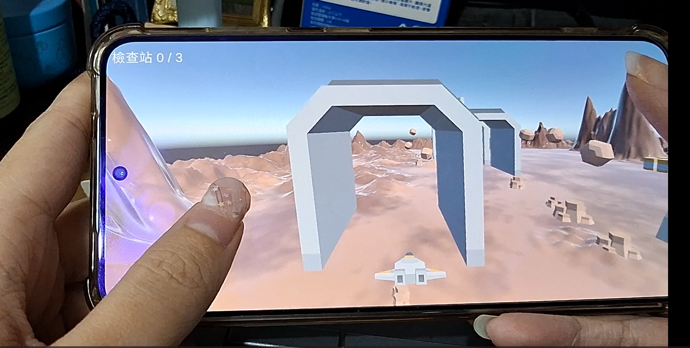
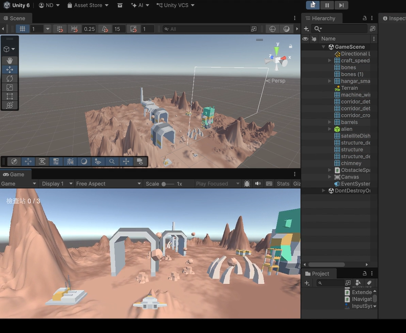
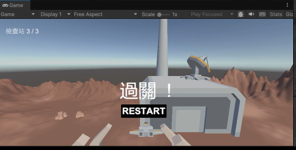
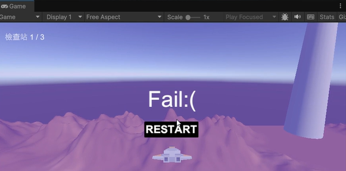

# 1151VR-HW4-414262351-DPT

- YouTube : <https://youtu.be/TygZAOsDD7A?si=OzHix4sE9RDsv003>
- GitHub : <https://github.com/cheese91383/1151VR-HW4-414262351-DPT>

## 成品功能

- 太空船自動往前飛，電腦用方向鍵／WASD、手機用觸控（按住螢幕哪一側就往哪飛）控制上下左右。
- 障礙物每次開始時隨機生成，不會互相重疊。
- 依序穿過 3 個通道檢查站，最後飛進機庫（hangar）過關。
- 撞到障礙物、驚險閃過、通過檢查站、抵達終點各有音效。
- 失敗條件：飛到底卻沒有進入機庫。
- 過關或失敗後按 RESTART 或點螢幕重新開始。

## 製作流程

### 1. 匯入素材

- 模型：Kenney Space Kit（<https://kenney.nl/assets/space-kit>），拖進 `Assets/Models`。飛機用 craft_speeder，障礙物用 rock、meteor、bones，檢查站用 corridor，終點用 hangar。
- 音效：使用 Kenney Interface Sounds（<https://kenney.nl/assets/interface-sounds>），放進 `Assets/Audio`。

| 欄位 | 音效檔 | 播放時機 |
|---|---|---|
| Hit Clip | error_003 | 撞到障礙物 |
| Pass Clip | drop_003 | 通過檢查站 |
| Finish Clip | confirmation_004 | 抵達終點 |
| Dodge Clip | confirmation_003 | 閃過障礙物 |

### 2. 場景與地形

- Terrain 建立地形，用 Raise or Lower Terrain 畫山丘。
- Paint Texture 新增砂色與岩石色兩個 Terrain Layer 上色。
- 相機設為飛機的子物件，放在後上方，形成追尾視角。

### 3. 腳本

在 `Assets/Script` 建立三個腳本：

| 腳本 | 掛在 | 功能 |
|---|---|---|
| `PlaneController.cs` | 飛機 | 移動、邊界、音效、碰撞、檢查站計數、UI、重新開始 |
| `ObstacleSpawner.cs` | 空物件 | 隨機擺放障礙物 |
| `Checkpoint.cs` | corridor、hangar | 自動產生觸發範圍 |

| 功能 | 做法 |
|---|---|
| 移動 | 在 FixedUpdate 用 `rb.MovePosition` 往前飛，並加上玩家輸入的上下左右。Rigidbody 不受重力、鎖住旋轉，碰撞偵測用 Continuous Speculative，避免手機上穿過障礙物。 |
| 邊界 | 用 `Mathf.Clamp` 把高度和左右位置限制在範圍內。 |
| 隨機障礙物 | 在出生點前方隨機取位置，用 `Physics.OverlapBox` 檢查有沒有重疊，重疊就重抽；離出生點太近也重抽。自動加上 BoxCollider 與 `Obstacle` 標籤。 |
| 檢查站 | Checkpoint 在 Awake 時算出模型範圍，自動加一個 Is Trigger 的 BoxCollider。飛機進入時 `OnTriggerEnter` 計數，每個只算一次。 |
| 撞擊音效 | `OnCollisionEnter` 碰到標籤是 Obstacle 的物件時播放。 |
| 閃避音效 | 飛機飛過障礙物後端、沒撞到、且距離夠近時播放。 |
| 失敗 | 飛過終點後一段距離（Overshoot）還沒進入機庫，顯示失敗畫面。 |
| 重新開始 | `SceneManager.LoadScene` 重新載入目前場景。 |

### 4. Inspector 設定

| 欄位 | 說明 | 預設值 |
|---|---|---|
| Forward Speed | 往前飛的速度 | 30 |
| Move Speed | 上下左右的速度 | 60 |
| Min / Max Height | 飛行高度範圍 | 10 / 90 |
| Max Side | 從出生點往左右最多飛多遠 | 200 |
| Overshoot | 飛過終點多遠算失敗 | 20 |
| Dodge Distance | 離障礙物多近飛過算「閃過」 | 30 |
| Hit / Pass / Finish / Dodge Clip | 撞擊、通過、過關、閃避音效 | |
| Clear / Fail Panel | 過關、失敗畫面 | |
| Is Finish（Checkpoint） | hangar 要勾選，當作終點 | |

### 5. UI

- GameObject 選 UI (Legacy) 的 Text 建立檢查站文字，Canvas Scaler 設 Scale With Screen Size。
- 建立 ClearPanel 與 FailPanel，各放一個 RESTART 按鈕，On Click 選 PlaneController 的 Restart。

### 6. 在 Android 上執行

- Player 設定：Default Orientation 選 Auto Rotation（只勾橫向），Active Input Handling 選 Input Manager (Old)，EventSystem 換成 Standalone Input Module。
- 音效設定：勾 Preload Audio Data，DSP Buffer Size 選 Best latency，減少手機音效延遲。
- 按 Build 輸出 APK，安裝到手機。
